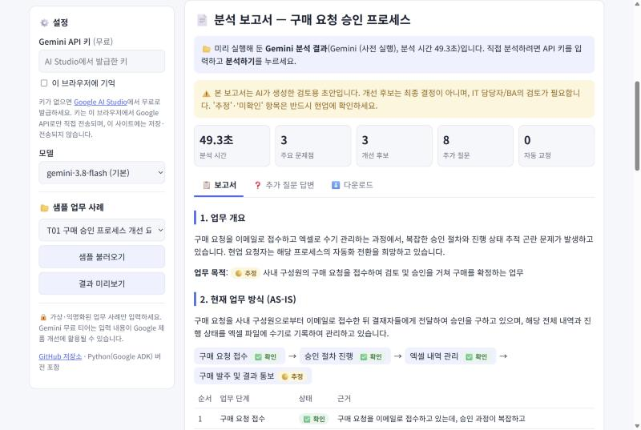
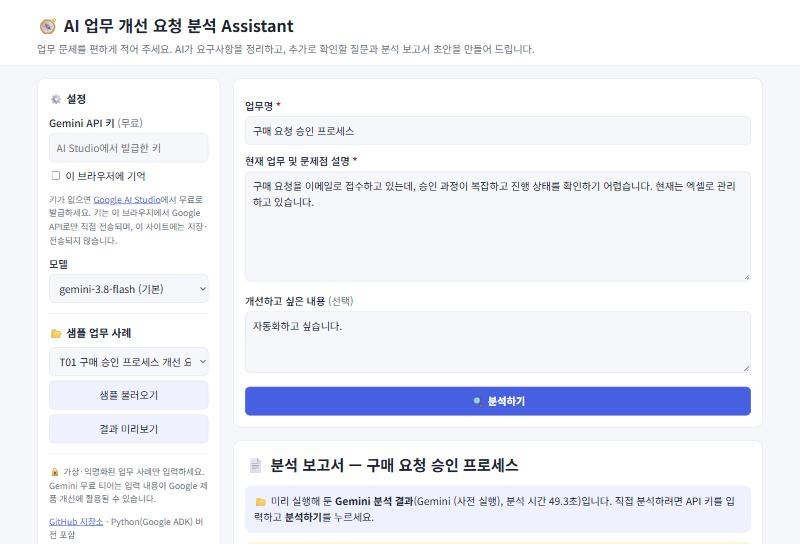
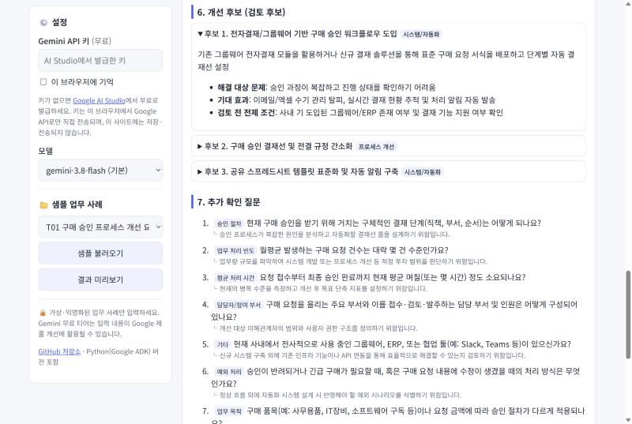

# 🧭 AI 업무 개선 요청 분석 Assistant

현업 부서의 **업무 개선·자동화 요청**(자유 문장)을 AI Agent가 분석해,
요구사항을 표준 항목으로 구조화하고 **추가로 확인할 질문**을 만들고, IT 담당자/BA가 검토할
**분석 보고서 초안(As-Is / To-Be 포함)**을 생성하는 AI Agent 웹서비스입니다.

> Main Quest 2 — "내 도메인에서 AI로 개선 지점 찾아서 PoC 만들기"

### 🌐 바로 써 보기: https://crystalmoon74.github.io/MainQuest2_AI-Business-Improvement-Assistant/
- API 키 없이: 왼쪽 **샘플 업무 사례** → **결과 미리보기** (미리 실행해 둔 Gemini 분석 결과)
- 직접 분석: [Google AI Studio](https://aistudio.google.com/apikey)에서 **무료 Gemini 키** 발급 → 왼쪽 설정에 입력 → **분석하기**
  (키는 방문자 브라우저에서 Google API로만 전송되며 사이트에는 저장되지 않습니다)



| 제출 항목 | 위치 |
|---|---|
| 문제 정의서 | [docs/01_문제정의서.md](docs/01_문제정의서.md) |
| PoC 코드 + 모델 선정 근거 | [agent/](agent/), [app.py](app.py), [docs/02_모델선정근거.md](docs/02_모델선정근거.md) |
| 사용 AI | **Google ADK + Gemini (무료 티어, 기본)** · Claude API (유료, 선택) · 규칙 기반 기준선 |
| 개선 효과 검증 | [docs/03_개선효과검증.md](docs/03_개선효과검증.md), [eval/](eval/) |
| 공개 데모 | https://crystalmoon74.github.io/MainQuest2_AI-Business-Improvement-Assistant/ |
| 실행 방법·시연 | 이 문서 |

---

## 1. 주요 기능 (PRD 대응)
| ID | 기능 | 구현 |
|---|---|---|
| F01 | 업무 개선 요청 입력 | 업무명·문제점(필수), 개선 희망(선택) 입력 + 필수값 검증 메시지 |
| F02 | AI 요구사항 분석 | 업무 목적, AS-IS 절차, 문제점, 개선 목적·기대효과, To-Be 가안, 개선 후보 |
| F03 | 누락 정보 식별·질문 | 7개 점검 범주 기준 최대 10개 질문, 이미 확인된 범주는 질문 제외 |
| F04 | 분석 보고서 표시 | 8개 섹션 표준 보고서, 모든 사실에 ✅확인 / 🟡추정 / ⚪미확인 + 근거 표시 |
| F05 | 추가 답변 반영 | 질문에 답하면 원 요청+답변으로 재분석해 보고서 갱신 |
| F06 | 보고서 다운로드 | Markdown 다운로드 |
| 신뢰성 | 가드레일 | '확인'인데 원문에 인용 근거가 없으면 자동으로 '추정'으로 강등하고 교정 내역 표시 |

## 2. 동작 구조 (단일 Agent)
같은 분석 원칙(프롬프트)·보고서 스키마·가드레일을 두 가지 형태로 제공합니다.

| 버전 | 위치 | AI 호출 | 용도 |
|---|---|---|---|
| **Python + Google ADK** (PoC 본체) | `agent/`, `app.py` (Streamlit) | ADK `LlmAgent` → Gemini | 로컬 실행, 평가 재현 |
| **웹 버전** (GitHub Pages) | `web/` | 브라우저 → Gemini REST API (방문자 키) | 누구나 설치 없이 사용 |

웹 버전의 프롬프트·스키마는 `python scripts/export_web_config.py`로 Python 원본에서 생성하므로 두 버전이 어긋나지 않습니다.

```
[입력] ─▶ ① 입력 검증 ─▶ ② ADK LlmAgent(Gemini) 구조화 분석 (Pydantic output_schema 강제)
                              · 요구사항 구조화 · 누락 정보 식별 · 질문 생성
        ─▶ ③ 가드레일 검증 (원문 인용 대조, 질문 중복/10개 제한)
        ─▶ ④ 보고서 표시 / Markdown 다운로드
        ─▶ (F05) 질문 답변 입력 ─▶ ②~④ 재실행
```
```
app.py                  Streamlit 화면
agent/schema.py         보고서 스키마 (확인/추정/미확인 + 근거)
agent/prompts.py        시스템 프롬프트(분석 원칙)
agent/analyzer.py       Agent 절차(검증→분석→가드레일), 엔진 선택, Claude 호출(선택)
agent/adk_agent.py      Google ADK LlmAgent + Gemini 호출 (기본 엔진)
agent/guardrails.py     사실 확정 오류 자동 교정
agent/baseline.py       규칙 기반 비교 기준선 / 데모 모드
agent/report.py         Markdown 보고서 생성
samples/test_cases.json PRD 테스트 사례 T01~T05
eval/run_eval.py        일괄 평가 스크립트
web/                    GitHub Pages 웹 버전 (index.html, app.js, 자동 생성 config.js·data/)
scripts/export_web_config.py  Python 프롬프트·스키마·평가 결과 → web/ 내보내기
.github/workflows/pages.yml   web/ 변경 시 GitHub Pages 자동 배포
```

## 3. 실행 방법
### 3-1. 설치
```bash
python -m pip install -r requirements.txt
```
> Windows의 '스마트 앱 컨트롤'이 켜져 있으면 일부 최신 패키지 DLL(jiter, numpy)이 차단될 수 있습니다.
> requirements.txt는 차단되지 않는 jiter 버전으로 고정했고, 화면은 numpy 없이 동작하도록 만들었습니다.

### 3-2. 무료 Gemini API 키 설정 (소스코드에 넣지 않음)
1. https://aistudio.google.com/apikey 에서 Google 계정으로 로그인 → **Create API key** (결제 정보 불필요, 무료 티어)
2. 환경변수 설정

PowerShell (현재 창만):
```powershell
$env:GOOGLE_API_KEY = "AIza..."
```
PowerShell (영구 저장, 새 터미널부터 적용):
```powershell
[Environment]::SetEnvironmentVariable("GOOGLE_API_KEY", "AIza...", "User")
```
macOS/Linux:
```bash
export GOOGLE_API_KEY=AIza...
```
- 기본 모델은 `gemini-3.8-flash`(무료 티어). 무료 한도(분당·일일 요청 수)를 넘으면 `GEMINI_MODEL=gemini-3.5-flash-lite`처럼 바꿔 쓸 수 있습니다.
- 무료 티어는 입력 내용이 Google 제품 개선에 활용될 수 있으므로 **가상·익명 사례만** 입력하세요.
- 키가 없으면 **규칙 기반 데모 모드**(AI 미사용)로만 동작합니다. `ANTHROPIC_API_KEY`가 있으면 Claude(유료)도 선택할 수 있습니다.

### 3-3. 웹앱 실행
```bash
python -m streamlit run app.py
```
브라우저에서 http://localhost:8501 → 왼쪽 **샘플 업무 사례**에서 T01~T05를 불러오거나 직접 입력 → **분석하기**.

### 3-4. 평가 재현
```bash
python eval/run_eval.py --mode gemini
```
```bash
python eval/run_eval.py --mode demo
```
결과: `eval/results/<mode>/` 에 사례별 JSON·Markdown 보고서와 `summary.md`(지표 표).

### 3-5. 웹 버전 갱신
프롬프트·스키마를 고쳤거나 평가를 다시 돌렸다면:
```bash
python scripts/export_web_config.py
```
그다음 commit·push 하면 GitHub Actions가 Pages에 자동 배포합니다. 로컬 확인은 `python -m http.server 8600 --directory web`.

## 4. 시연
공개 데모(웹 버전)에서 T01 "구매 승인 프로세스 개선 요청"을 Gemini로 분석한 결과입니다.

**① 요청 입력** — 업무명·문제점(필수), 개선 희망(선택). 샘플 사례 불러오기 지원


**② 분석 보고서** — 지표 요약, AS-IS 절차 흐름(확인/추정 배지), 원문 근거 표


**③ 개선 후보와 추가 확인 질문** — 시스템·프로세스 대안을 검토 후보로 제시, 범주별 질문과 필요한 이유


**Gemini 평가 요약 (T01~T05)** — 자세한 내용은 [개선 효과 검증](docs/03_개선효과검증.md)
| 지표 | 결과 |
|---|---|
| 정상 동작 | 5/5 |
| 분석 시간 | 18.8~51.2초 (평균 35.6초, 목표 60초 이내) |
| 추가 질문 | 사례당 6~9개 (≤10), 중복 질문 0 |
| 점검 범주 커버리지 | 4건 7/7, 1건 6/7 |
| 사실 확정 오류 | 가드레일 탐지 0건, 사람 검토로 2건 발견·기록 |

## 5. 보안·개인정보
- 가상 또는 익명화된 업무 사례만 사용합니다. 입력은 저장하지 않으며(세션 메모리에만 존재), 분석을 위해 선택한 AI 서비스(기본: Google Gemini API)로 전송됩니다.
- API 키는 환경변수로만 관리합니다. 웹 버전은 방문자가 자기 키를 입력하며, 키는 그 브라우저에서 Google API로만 전송됩니다('이 브라우저에 기억'을 켠 경우에만 브라우저 localStorage에 저장).
- Gemini **무료 티어는 입력이 Google의 제품 개선에 사용될 수 있어** 실제 사내 데이터에는 부적합합니다. 실제 도입 시 유료 티어 또는 사내 승인된 모델이 필요합니다.
- AI 결과는 **참고용 초안**이며 사람의 검토가 필요하다는 안내를 화면과 보고서에 표시합니다.

## 6. 한계 및 다음 단계
- 가드레일은 '확인' 항목의 **인용문 존재 여부**만 검사합니다. 인용은 맞지만 해석이 틀린 경우는 사람 검토가 필요합니다.
- 짧은 요청 위주로 설계했습니다. 긴 문서·첨부파일(엑셀, 프로세스 문서) 입력은 다음 단계.
- 검증에서 내용 과장(T01 '결재 지연·업무 혼선' 추가)이 가드레일을 통과했습니다 → 내용·인용 의미 일치를 보는 2차 검증이 다음 과제입니다.
- 다음 단계 후보: 분석 이력 저장, 요청 간 우선순위 평가, 자동화 적합성 점수, 프로세스 다이어그램 시각화, PDF 다운로드.
- 실제 도입 시 필요: 사내 데이터 처리 정책 검토(외부 API 전송), 비용 산정(요청당 토큰 사용량은 `eval` 결과의 output_tokens 참고), 현업·BA 피드백 수집 루프.
